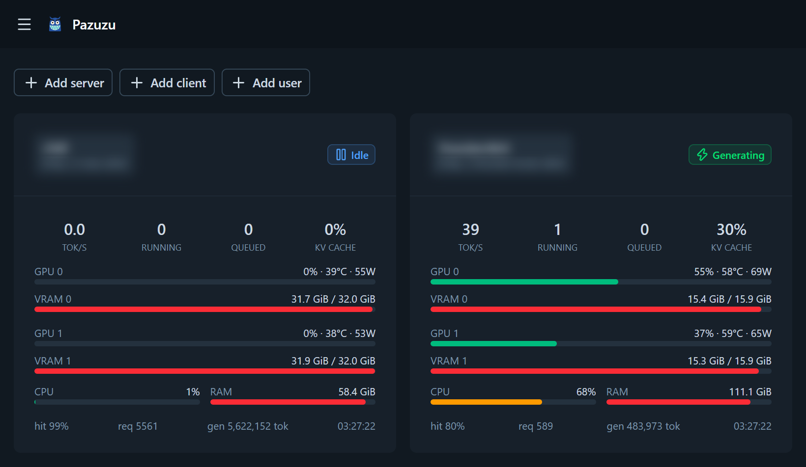
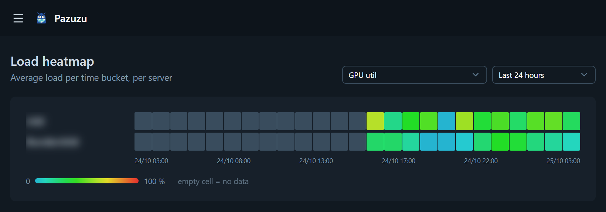

# Pazuzu

**English** · [Русский](docs/README.ru.md) · [中文](docs/README.zh.md)

Web monitoring for **[Strata](https://github.com/Niko1221/Strata)** inference
engines: several servers, a live dashboard, metric history and a load heatmap
with selectable period.





## Features

- **Multiple servers** — add a Strata engine by base URL
  (e.g. `http://192.168.10.76:8000`), metrics are read from `/metrics`
  (Prometheus text format, `Accept: text/plain` header required).
  An optional API key is sent as a `Bearer` token — newer Strata versions
  require it when the server is exposed to the network.
- **Live dashboard** — engine state (idle / reading / generating),
  tok/s, queues, KV cache, per GPU: util / VRAM / temperature / power,
  plus host CPU and RAM. Updates over WebSocket with a polling fallback.
- **History** — charts per server for 1h / 6h / 24h / 7d / 30d.
- **Heatmap** — load of all servers by time buckets, periods of
  1h / 3h / 12h / 24h / 7d / 30d / year, selectable metric (GPU util, CPU, tok/s,
  queue, VRAM %, power, hit rate, etc.). Period and metric are remembered
  per browser (cookie).
- **Settings** — poller interval and rollup interval (30 s by default),
  retention depth for raw data and hourly aggregates. Applied on the fly.
- **Self-update** — the sidebar shows the running commit, `origin` is checked
  every 6 hours, and Settings → Updates pulls, rebuilds and restarts the
  server in one click (admins while auth is on).
- **Theme** — light / dark / system: quick toggle in the sidebar (a drawer
  on mobile) or a selector in Settings; the color scheme is Standard
  (built-in defaults: an intense bioluminescent cyan accent over
  deep-sea rock neutrals) or
  Custom (accent and neutral palettes picked per browser, localStorage).
- **Mascot** — a horned grinning monster whose smile is a cyan load-chart
  zigzag: `public/logo.svg` in the sidebar and on the login page,
  `public/favicon.svg` as the tab icon; empty states are watched by a pair
  of glowing eyes (`AbyssEyes.vue`).
- **i18n** — UI in English, Russian, German, Spanish, French and Chinese;
  language is auto-detected from the browser and can be pinned per account
  in Settings (the `pazuzu_locale` cookie remembers the choice until a
  language is saved on the account). Strings live in
  `i18n/locales/*.json`, a new language = one JSON file + an entry in
  `nuxt.config.ts`.
- **Optional authentication** — enable `auth.enabled` in `config.json`;
  accounts live in SQLite with scrypt-hashed passwords and 30-day sliding
  sessions, with `admin`/`user` roles. With auth on and no users yet, the app
  opens a first-run screen to create the admin account. Users can also sign
  in through a GitLab server on the LAN (OAuth2, see
  [Authentication](#authentication)).
- **API gateway (optional)** — one OpenAI-compatible endpoint (`/v1`) that
  load-balances across all your engines: per-app API tokens (`msk_…`),
  a priority queue with aging, session-aware routing (a chat keeps hitting
  the engine that holds its KV prefix cache), per-server routing modes
  (route / drain / stats-only) and source-IP tracking. Off by default,
  enable with `gateway.enabled` in `config.json` — see
  [Gateway](#gateway-load-balancer).

## Installation

```sh
git clone https://github.com/Crdls/Pazuzu.git
cd Pazuzu
npm install --omit=dev
npm run build
```

If the host is busy and short on free RAM (e.g. it runs Strata too), the
install or build step may get killed with exit code 135 — cap the Node heap:
`NODE_OPTIONS=--max-old-space-size=1024 npm install --omit=dev` (same for
`npm run build`).

## Updating

The running build is a git checkout, so Pazuzu knows its own commit and
shows it in the sidebar; clicking that line checks for updates on the spot.
Every 6 hours (or on "Check now") it asks `origin`
whether the branch moved; Settings → Updates then offers "Update & restart"
(admins while auth is on). That runs `scripts/autoupdate.mjs` in the
background: wait for the server to exit, `git pull --ff-only`,
`npm install --omit=dev`, `npm run build`, then start the server again — the
page reloads itself once the new build answers. The whole run is logged to
`data/update.log`; if a step fails (e.g. local changes blocking the pull)
the old build is restarted and Settings shows where it broke. In dev mode
updates are never applied.

`./update.sh` on Linux and `update.bat` on Windows do the same steps by hand
and also fit a fresh clone (the pull is a no-op there). Restart the server
afterwards to apply the new build.

## Running

```sh
node .output/server/index.mjs    # http://localhost:3000
```

Serving to the local network on a specific address and port (any host/port
work the same way):

```sh
NITRO_HOST=0.0.0.0 NITRO_PORT=3003 node .output/server/index.mjs
```

The database is a SQLite file `data/data.db` (created automatically).
Its path can be changed with `db.path` in `config.json` (applied at startup).
System settings live in `config.json` in the project root — see
[Authentication](#authentication).

## Authentication

System-level settings live in `config.json` next to the project root — copy
`config.json.example` to `config.json`:

```json
{
  "db": { "path": "data/data.db" },
  "auth": { "enabled": true }
}
```

The file is optional (absent = defaults: `data/data.db`, auth off).
`auth.enabled` applies as soon as the file changes; `db.path` applies at
startup — restart after changing it (relative paths resolve from the project
root). Admins can also edit all of this from the **System configuration**
card on the Settings page: saving rewrites `config.json` in place (extra
keys added by hand survive it) and the values apply immediately — only
`db.path` needs a restart. With auth off the card is open to everyone on
the network, like the rest of the app.

With auth enabled:

- no users yet → the app opens a first-run screen to create the admin account;
- every API route and the WebSocket require the `pazuzu_session` cookie
  (HttpOnly, scrypt-hashed passwords in SQLite, sessions live 30 days and
  slide on use);
- two roles: `admin` and `user`; admins get a **Users** page where they can
  change roles, assign a new password to anybody (without knowing the old
  one), freeze accounts (frozen users cannot sign in and their active
  sessions are dropped) and delete users — the last active admin can never
  be demoted, frozen or deleted, and nobody can demote or freeze themselves;
- servers remember who added them: editing, deleting and toggling a server
  is allowed to its creator and to admins only (with auth off everybody
  may do everything, as before);
- the interval and retention settings and the **System configuration** card
  (edits `config.json`) on the Settings page are editable by admins only
  (the password and appearance cards stay available to everyone);
- sign out in the sidebar; the Settings page can change your own password
  (the current session stays signed in, others are signed out).

### Sign in with GitLab

Instead of (or next to) local passwords you can authenticate against a
GitLab server on your LAN with OAuth2 (authorization code, scope
`read_user`) — no extra service needed:

1. In GitLab create an OAuth application (your profile → Applications, or
   Admin Area → Applications to offer it to everyone). Its redirect URI
   must be the **full URL of Pazuzu's OAuth callback endpoint**:
   `http://<pazuzu-host>:3003/api/auth/gitlab/callback`. GitLab matches
   this string exactly — the bare host `http://<pazuzu-host>:3003` is
   *not* enough: GitLab would then deliver the code to `/`, which nobody
   handles, and you would land back on the login page with no error.
   Select the `read_user` scope;
2. put the application id/secret into `config.json`:

```json
"auth": {
  "enabled": true,
  "gitlab": {
    "enabled": true,
    "baseUrl": "http://gitlab.lan",
    "clientId": "…",
    "clientSecret": "…",
    "allowedGroups": [],
    "caCert": "",
    "insecureTls": false
  }
}
```

- the login page gains a "Sign in with GitLab" button;
- the first GitLab sign-in creates a local user with the same username and
  the admin role (it can only happen while no users exist); later GitLab
  sign-ins are created as plain `user` accounts — an admin promotes them on
  the Users page; new GitLab users carry a "GitLab" badge, have no password
  and can set a local one in Settings (the card asks for a new password
  only, no current one) to keep signing in when GitLab is down;
- `allowedGroups` (optional) restricts sign-in to members of those GitLab
  groups; members of subgroups count too; an empty list lets any GitLab
  user of that server sign in;
- `redirectUri` (optional) overrides the callback URL derived from the
  request — you only need it behind a reverse proxy that rewrites the host.
  Like the GitLab application setting it must be the full callback URL
  ending in `/api/auth/gitlab/callback`, exactly as registered in GitLab;
- when GitLab serves a certificate from an internal CA, your browser opens
  it happily but the sign-in fails with "Could not sign in with GitLab"
  (`SELF_SIGNED_CERT_IN_CHAIN` in the server log): Node does not use the
  OS certificate store. Point `caCert` at a PEM file with the CA certificate
  (relative paths resolve from the project root; it is trusted *on top of*
  the regular CAs) — or, on a fully trusted LAN, set `insecureTls: true` to
  skip certificate verification for GitLab requests only.

Lost password? On the server, from the project root (no email involved,
the server may keep running):

```sh
node scripts/reset-password.mjs --list
node scripts/reset-password.mjs <username or id> [new password]
```

The reset signs all sessions of that user out.

## Gateway (load balancer)

Pazuzu can also be the single entry point for applications calling the
engines — one OpenAI-compatible endpoint in front of all of them:

```
POST http://<pazuzu-host>:3003/v1/chat/completions
Authorization: Bearer msk_…
```

Everything under `/v1` is forwarded transparently (chat completions, models,
assorted compatible routes), streaming included. Off by default — turn it on
in `config.json`:

```json
"gateway": { "enabled": true }
```

- **Clients** — the **Clients** page (admins only when auth is on) manages
  the API tokens that may call the gateway: an auto-generated `msk_…` key
  (shown exactly once, only its hash is stored) or your own token; tokens can
  be disabled and rotated, carry a priority and an optional debug flag that
  adds `X-Pazuzu-Server`, `X-Pazuzu-Queue-Wait-Ms` and
  `X-Pazuzu-Session` response headers. Each client gets request counters
  and a source-IP history; token usage is tallied from the engine's `usage`
  chunk when the client asks for it (e.g. `stream_options.include_usage`),
  otherwise it is a bytes/4 estimate — stats, not billing.
- **Per-client server access** — each client can be limited to a set of
  engines: the Clients page picks the servers reachable by a client, the
  Servers page picks which clients a server is available to (both with
  select-all / select-none buttons). A new client reaches every server; it
  also keeps reaching servers added later until some are unchecked.
  Unchecking an unrestricted client on the Servers page limits it to the
  other current servers.
- **Session affinity** — a chat sticks to the engine that holds its KV
  prefix cache: the `X-Session-Id` header decides when the client sends it,
  otherwise the hash of the conversation opening (system + first user
  message) keys the mapping; chats idle for longer than `sessionIdleMin`
  (60 min) may land elsewhere.
- **Least-loaded routing** — a new chat goes to the least loaded engine,
  each capped by concurrency: the per-server `gateway capacity` on the
  Servers page, else the engine's own batch slots (`strata:live_slots`),
  else `defaultCapacity` (32). A server temporarily stops taking new work
  while the engine reports a waiting queue, its KV cache above 95%, or right
  after a live request failed against it (`ejectionS`, 30 s).
- **Priority queue** — when every engine is at capacity requests wait in the
  strict-priority lanes (high / normal / low per client) with round-robin
  fairness between clients of a lane; waiting gradually promotes a request
  (low → normal after 30 s, then → high after 5 min more) so nobody starves.
  A request that waited `queueTimeoutS` (60 s) or hit the queue caps gets an
  OpenAI-style `429` with `Retry-After`. The queue lives in memory — a
  Pazuzu restart drops waiting requests (in-flight ones finish).
- **Detaching a server** — per-server gateway mode on the Servers page:
  **Route** (default), **Drain** (only finish in-flight requests) or
  **Stats** (monitoring only, the gateway never forwards to it).
- The `gateway` section of `config.json` also accepts `queueTimeoutS`,
  `queueMax` (200), `queueMaxPerClient` (20), `sessionIdleMin`,
  `defaultCapacity` and `ejectionS` — everything has a sane default.

## Data storage

| tier | resolution | default retention |
|---|---|---|
| `samples` | every poller cycle (~10 s) | 48 hours |
| `rollup_hourly` | hourly buckets (avg/max/min) | 400 days |
| `rollup_daily` | daily buckets | forever |

Counters (`*_total`) are turned into rates (`derived:*`) while scraping:
`gen_tok_s`, `prompt_tok_s`, `req_s`, window averages `_sum/_count` for
TTFT / ITL / E2E, engine and memory busy percentages.

## Structure

```
app/            Vue 3 + Nuxt UI frontend
  pages/        dashboard, server, heatmap, servers, clients, users, settings, login
  components/   ServerCard, MetricChart (uPlot), LoadHeatmap, ...
  plugins/live.ts  shared state + WebSocket client
i18n/locales/   dictionaries: en, ru, de, es, fr, zh
server/
  middleware/   auth.ts - session gate for /api (opt-in via config.json)
  utils/        Prometheus parser, SQLite, metric catalog, scraper, rollups,
                auth primitives, permission rules, GitLab OAuth helpers,
                gateway/ (routing, priority queue, session affinity, proxy)
  plugins/      background loops (scrape, rollups, gateway, update check)
  api/          servers CRUD, live, range, heatmap, settings, auth, users,
                gateway (status, clients, rotate, IPs), update (status/check/apply)
  routes/       _ws.ts WebSocket endpoint, v1/[...].ts gateway proxy
scripts/        reset-password.mjs - lost password recovery (no email)
                autoupdate.mjs - applied by the Update button: pull + install
                                 + build + restart (log: data/update.log)
test/           parser test on real /metrics fixtures + auth/config/gateway/client-access/update tests
update.sh|.bat  one-shot install/update: pull + install --omit=dev + build
```

## API

- `GET|POST /api/servers`, `PATCH|DELETE /api/servers/:id`, `POST /api/servers/:id/ping` (PATCH/DELETE: creator or admin only when auth is on)
- `GET /api/live` — current snapshots of all servers
- `GET /api/range?serverId&metric&from&to` — metric history (raw/hourly/daily — the source is picked automatically)
- `GET /api/heatmap?metric&period=1h|3h|12h|24h|7d|30d|1y` — servers × buckets matrix
- `GET|PUT /api/settings` (`PUT`: admin only when auth is on)
- `GET /api/update/status` — running commit and update availability; `POST /api/update/check` — re-check now; `POST /api/update/apply` — pull, rebuild and restart via `scripts/autoupdate.mjs` (admin only when auth is on; disabled in dev mode)
- `/api/auth/status|setup|login|logout|password` — auth (public: status, setup, login, logout)
- `GET /api/auth/gitlab/start` — redirect to GitLab; `GET /api/auth/gitlab/callback` — the OAuth callback endpoint: register exactly this URL as the redirect URI in the GitLab application
- `GET /api/users`, `PATCH|DELETE /api/users/:id` — user management (admins only; PATCH takes `role`, `disabled`, `password`)
- `GET /api/gateway/status` — queue lanes and per-server gateway load (admin only when auth is on)
- `GET|POST /api/gateway/clients`, `PATCH|DELETE /api/gateway/clients/:id`, `POST /api/gateway/clients/:id/rotate`, `GET /api/gateway/clients/:id/ips` — gateway API tokens (admins only when auth is on; POST/rotate return the raw token once; the view and POST/PATCH carry `serversAll`/`serverIds`)
- `PUT /api/gateway/servers/:id/clients` — set which clients may route through that server (admin only when auth is on)
- `/v1/**` — OpenAI-compatible gateway, authenticated by client tokens (`Authorization: Bearer msk_…`), not by the session cookie — see [Gateway](#gateway-load-balancer)
- `WS /_ws` — push snapshots

## Tests

```sh
node test/parse.test.mjs
node test/auth.test.mjs
node test/config.test.mjs
node test/gateway.test.mjs
node test/client-access.test.mjs
node test/update.test.mjs
```

## Notes

- Node ≥ 22.22 / 24.15 is required (older Node 24 builds of Nuxt 4.6 may
  complain with EBADENGINE).
- `nuxt.config.ts` contains two important environment workarounds:
  - `nitro.externals.inline` — a Windows-only hack until
    [nuxt/nuxt#36467](https://github.com/nuxt/nuxt/issues/36467) is fixed
    (without it the whole SSR returns 500);
  - `nitro.experimental.websocket: true` — enables the WebSocket upgrade
    attach in the server preset (otherwise `/_ws` works neither in dev
    nor in production).
- Strata's `/metrics` returns JSON without the `Accept: text/plain`
  header — the scraper always sends it.
- Authentication is off by default (the service is meant for a trusted local
  network); when enabled, all `/api` routes except the auth bootstrap ones
  and `/_ws` require a valid session cookie.
- The `/v1` gateway is off by default too, and it is deliberately *not*
  gated by the session cookie — clients authenticate with their own
  `msk_…` API tokens there.

## Acknowledgments

Genuine, deep respect to [Niko1221](https://github.com/Niko1221/Strata) for
[Strata](https://github.com/Niko1221/Strata) — the engine this monitor watches:
without it there would simply be nothing to chart here.

The monitor itself is assembled from open-source parts:

- [Nuxt](https://nuxt.com/) 4 (on [Vue](https://vuejs.org/) 3, served by Nitro)
  — the UI app, the API routes and the WebSocket endpoint;
- [Nuxt UI](https://ui.nuxt.com/) and [Tailwind CSS](https://tailwindcss.com/)
  — components and styling, with [Lucide](https://lucide.dev/) icons;
- [uPlot](https://github.com/leeoniya/uPlot) — the history charts;
- [better-sqlite3](https://github.com/WiseLibs/better-sqlite3) — SQLite storage;
- [Nuxt i18n](https://i18n.nuxtjs.org/) — the six interface languages;
- [TypeScript](https://www.typescriptlang.org/) — all of the above.

## License

Released under the terms of the [MIT License](LICENSE) — the full text lives
in the [`LICENSE`](LICENSE) file at the repository root.
