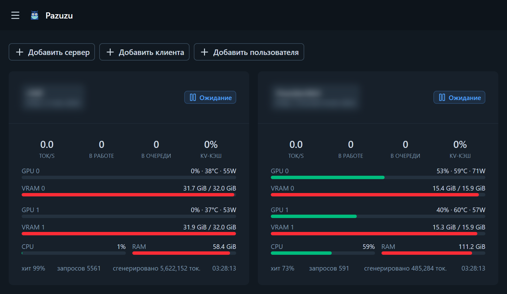
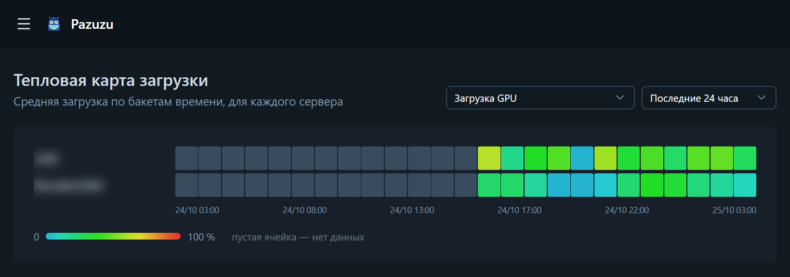

# Pazuzu

[English](../README.md) · **Русский** · [中文](README.zh.md)

Web-мониторинг движков инференса **[Strata](https://github.com/Niko1221/Strata)**:
несколько серверов, live-дашборд, история метрик и тепловая карта загрузки
с выбором периода — а если захотеть, ещё и единая OpenAI-совместимая точка,
разкладывающая запросы приложений между всеми движками.





## Возможности

- **Несколько серверов** — добавляете Strata-движок по базовому URL
  (например `http://192.168.10.76:8000`), метрики читаются с `/metrics`
  (Prometheus text format, заголовок `Accept: text/plain`).
  Необязательный API-ключ отправляется как `Bearer`-токен — новые версии
  Страты требуют его, если сервер смотрит наружу. Кнопка «Тест» сразу
  показывает, достижим ли движок и читается ли с него `/metrics`.
- **Live-дашборд** — состояние движка (idle / reading / generating),
  tok/s, очереди, KV cache, по каждой GPU: util / VRAM / t° / мощность,
  CPU и RAM хоста. Обновление по WebSocket с fallback на polling.
- **История** — графики по каждому серверу за 1h / 6h / 24h / 7d / 30d.
- **Тепловая карта** — загрузка всех серверов по бакетам времени,
  периоды 1ч / 3ч / 12ч / 24ч / 7д / 30д / год, выбор метрики (GPU util, CPU, tok/s,
  очередь, VRAM %, мощность, hit rate и др.). Период и метрика запоминаются
  в браузере (cookie).
- **Настройки** — разбиты на вкладки (любая открывается ссылкой вида `?tab=`):
  **Личное** (оформление, язык, пароль, просмотр в роли), **Сбор данных**
  (интервал поллера и интервал роллапа — по умолчанию 30 с — и глубина
  хранения часовых агрегатов, всё применяется на лету; с авторизацией —
  только админам), **Система** (правит `config.json` прямо из браузера и
  карточку обслуживания базы с кнопкой «Очистить сейчас»; с авторизацией —
  только суперадминам, значения конфига вступают сразу, один лишь путь к базе
  ждёт перезапуска) и **Обновление**.
- **Самообновление** — в сайдбаре виден текущий коммит сборки, `origin`
  проверяется каждые 6 часов, а кнопка «Обновить и перезапустить» в футере
  сайдбара (и в Настройках) подтягивает код, пересобирает и перезапускает
  сервер одной кнопкой (с авторизацией — только админам).
- **Тема** — светлая / тёмная / системная: быстрое переключение в сайдбаре
  (на мобилке — выдвижная панель) или выбор в Настройках; цветовая схема —
  Стандартная (фирменные дефолты: светящийся cyan-акцент над тёмной породой)
  или своя (акцент и нейтральная палитра выбираются вручную);
  хранится в браузере (localStorage).
- **Маскот** — рогатый ухмылак, чья улыбка — голубая зубчатая линия
  нагрузки: `public/logo.svg` в сайдбаре и на странице входа,
  `public/favicon.svg` — иконка вкладки; в пустых состояниях за
  интерфейсом наблюдают светящиеся глаза (`AbyssEyes.vue`).
- **i18n** — интерфейс на английском, русском, немецком, испанском, французском
  и китайском; язык по умолчанию определяется по браузеру, а фиксированный
  язык выбирается в Настройках и хранится в аккаунте
  (до фиксации язык помнит cookie `pazuzu_locale`). Строки — в `i18n/locales/*.json`,
  новый язык = один JSON-файл + запись в `nuxt.config.ts`.
- **Опциональная авторизация** — включается `auth.enabled` в `config.json`;
  аккаунты хранятся в SQLite, пароли — хеш scrypt, вход держится 30 дней
  и продлевается при использовании, роли — `superadmin`, `admin` и `user`. Если авторизация
  включена и пользователей
  ещё нет — приложение откроет экран создания первого аккаунта. Можно так же входить
  через GitLab-сервер в локальной сети (OAuth2, см. раздел «Авторизация»).
- **API-шлюз (опционально)** — единая OpenAI-совместимая точка (`/v1`),
  балансирующая нагрузку между всеми движками: API-токены приложений (`pzz_…`),
  приоритетная очередь с aging, маршрутизация по сессиям (чат продолжает
  попадать на движок, где лежит его KV-префикс), режимы маршрутизации серверов
  (маршрут / слив / только статистика), предпочтение движков по клиентам
  (своё железо — первым) и история IP-адресов; страница
  «Клиенты» заодно служит пультом шлюза — живые очереди и загрузка каждого
  движка. По умолчанию выключен, включается `gateway.enabled` в `config.json`
  или в Настройках — см. раздел «Шлюз (балансировщик)».

## Установка

```sh
git clone https://github.com/Crdls/Pazuzu.git
cd Pazuzu
npm install --omit=dev
npm run build
```

Если на хосте мало свободной памяти (например, там же крутится Strata),
установку или сборку может убивать с кодом 135 — ограничьте кучу Node:
`NODE_OPTIONS=--max-old-space-size=1024 npm install --omit=dev` (и так же
с `npm run build`).

## Обновление

Рабочая сборка — это git-клон, поэтому Pazuzu знает свой коммит и показывает
его в сайдбаре; клик по этой строке проверяет обновления на месте. Каждые
6 часов (и по кнопке «Проверить») сервер спрашивает
`origin`, не ушла ли ветка вперёд; тогда в футере сайдбара (и в Настройках)
появляется кнопка «Обновить и перезапустить» для тех, кому это доступно
(с авторизацией — только админам). Она запускает
`scripts/autoupdate.mjs`: тот ждёт выхода сервера, выполняет
`git pull --ff-only`, `npm install --omit=dev`, `npm run build` и поднимает
сервер заново — страница сама перезагрузится, когда новая сборка ответит.
Весь прогон пишется в `data/update.log`; если шаг упадёт (например, локальные
правки мешают pull), поднимется старая сборка, и настройки покажут, на чём
всё сорвалось. В режиме разработки обновления не применяются.

`./update.sh` на Linux и `update.bat` на Windows делают те же шаги вручную и
подходят и для свежего клона (pull там ничего не делает). После них сервер
нужно перезапустить, чтобы применить новую сборку.

## Запуск

```sh
node .output/server/index.mjs    # http://localhost:3000
```

В локальную сеть на конкретном адресе и порте (host/port любые):

```sh
NITRO_HOST=0.0.0.0 NITRO_PORT=3003 node .output/server/index.mjs
```

База — SQLite-файл `data/data.db` (создаётся автоматически).
Путь меняется параметром `db.path` в `config.json` (применяется при старте).
Системные настройки — в `config.json` в корне проекта, см. раздел
«Авторизация» ниже.

## Авторизация

Системные настройки лежат в `config.json` в корне проекта — скопируйте
`config.json.example` в `config.json`:

```json
{
  "db": { "path": "data/data.db" },
  "auth": { "enabled": true }
}
```

Файл опционален (нет файла — значения по умолчанию: `data/data.db`,
авторизация выключена). `auth.enabled` применяется сразу при изменении файла,
`db.path` — при старте, после его изменения нужен перезапуск (относительные пути
отсчитываются от корня проекта). Все эти настройки суперадминистратор может править
и со страницы «Настройки» (вкладка «Система»): сохранение
переписывает `config.json` на месте (прописанные вручную дополнительные ключи
сохраняются), значения применяются сразу — только `db.path` требует
перезапуска. С выключенной авторизацией вкладка доступна всем в сети,
как и остальное приложение.

При включённой авторизации:

- пользователей ещё нет → приложение открывает экран создания первого аккаунта;
- каждый API-запрос и WebSocket требуют cookie `pazuzu_session`
  (HttpOnly, пароли — хеш scrypt в SQLite, сессия живёт 30 дней и продлевается);
- три роли: `superadmin`, `admin` и `user`; админы видят страницу «Пользователи», где можно
  менять роли, назначать любому новый пароль (без знания старого), замораживать
  аккаунты (замороженный не может входить, его активные сессии сразу сбрасываются)
  и удалять пользователей — кроме суперадминов: их аккаунтами и самой ролью
  `superadmin` управляют только суперадмины;
- первый админ-аккаунт и есть суперадмин: роль получает аккаунт с экрана
  первого запуска (и самый первый вход через GitLab), выдавать и снимать её
  может только суперадмин, а существующие базы обновляются сами — при старте
  самый старый активный админ становится суперадмином, если у роли нет
  активного носителя;
- через API нельзя заблокировать себя навсегда: последнего активного
  суперадмина нельзя понизить, заморозить или удалить, ровно как последнего
  активного админа (суперадмины считаются), а менять свою роль и замораживать
  себя нельзя никому;
- серверы запоминают, кто их добавил: редактировать, удалять и переключать
  сервер может только его автор и админы (с выключенной авторизацией — все,
  как раньше);
- на странице «Настройки» вкладка «Сбор данных» (интервалы и хранение) доступна
  только админам, вкладка «Система» (правка `config.json` и чистка базы) —
  только суперадминам; недоступных роли вкладок не видно вовсе, а «Личное»
  (пароль, оформление) остаётся для всех;
- «Просмотр в роли» («Настройки»): админ может временно смотреть весь
  интерфейс обычным юзером, суперадмин — ещё и админом: удобно для тестов и
  чтобы что-то пробовать без админских прав. Маска действует только на текущую
  сессию, прав никогда не добавляет, а в сайдбаре висит баннер с возвратом
  в один клик;
- выход — кнопка в сайдбаре; на странице «Настройки» можно сменить свой пароль
  (текущая сессия останется активна, остальные будут разлогинены).

### Вход через GitLab

Вместо локальных паролей (или рядом с ними) можно авторизоваться через
GitLab-сервер в локальной сети по OAuth2 (authorization code, область
`read_user`) — никакой отдельной IdP-службы не нужно:

1. В GitLab создайте OAuth-приложение (в профиле → «Приложения», или в
   Admin Area → «Приложения», чтобы предложить его всем). В поле redirect
   URI нужно указать **полный URL callback-эндпоинта Pazuzu**:
   `http://<хост-pazuzu>:3003/api/auth/gitlab/callback`. GitLab сверяет
   эту строку посимвольно — одного хоста `http://<хост-pazuzu>:3003`
   *недостаточно*: GitLab вернёт код на `/`, где его никто не обрабатывает,
   и вас просто выбросит на страницу входа без ошибки. Область — `read_user`;
2. внесите id/secret приложения в `config.json`:

```json
"auth": {
  "enabled": true,
  "gitlab": {
    "enabled": true,
    "baseUrl": "http://gitlab.lan",
    "clientId": "…",
    "clientSecret": "…",
    "allowedGroups": [],
    "caCert": "",
    "insecureTls": false
  }
}
```

- на странице входа появится кнопка «Войти через GitLab»;
- первый вход через GitLab создаёт локального пользователя с тем же логином
  и ролью суперадмина (это возможно, только пока пользователей нет); последующие
  GitLab-входы создают обычных пользователей `user` — повышать их должен
  админ на странице «Пользователи»; новые GitLab-пользователи помечены
  значком «GitLab», пароля у них нет, и они могут задать локальный пароль
  в «Настройках» (форма попросит только новый пароль, без текущего), чтобы
  входить и при недоступном GitLab;
- `allowedGroups` (необязательно) пускает только участников указанных
  групп GitLab; участники подгрупп тоже подходят; пустой список — вход
  разрешён любому пользователю этого GitLab;
- `redirectUri` (необязательно) переопределяет выводимый из запроса callback
  — нужен только за reverse-прокси, меняющим хост. Как и настройка в
  GitLab-приложении, это должен быть полный URL callback, оканчивающийся
  на `/api/auth/gitlab/callback` и ровно совпадающий с зарегистрированным;
- если GitLab отдаёт сертификат от внутреннего CA, браузер открывает его
  спокойно, а вход падает с «Не удалось войти через GitLab»
  (`SELF_SIGNED_CERT_IN_CHAIN` в логе сервера): Node не использует
  хранилище сертификатов ОС. Укажите в `caCert` путь к PEM-файлу с этим CA
  (относительные пути считаются от корня проекта; CA добавляется *поверх*
  обычных) — или, во полностью доверенной сети, поставьте `insecureTls: true`,
  чтобы отключить проверку сертификата только для запросов к GitLab.

Забыли пароль? На сервере, из корня проекта (никакой почты, сервер можно
не останавливать):

```sh
node scripts/reset-password.mjs --list
node scripts/reset-password.mjs <логин или id> [новый пароль]
```

Сброс разлогинивает все сессии пользователя.

## Шлюз (балансировщик)

Pazuzu может быть и единой точкой входа для приложений, которые обращаются
к движкам, — одна OpenAI-совместимая точка перед всеми ними:

```
POST http://<хост-pazuzu>:3003/v1/chat/completions
Authorization: Bearer pzz_…
```

Всё, что идёт на `/v1`, прозрачно проксируется (chat completions, модели и
прочие совместимые маршруты), включая стриминг. По умолчанию шлюз выключен —
включается в `config.json`:

```json
"gateway": { "enabled": true }
```

или на странице «Настройки», на вкладке «Система».

- **Клиенты** — страница «Клиенты» (с авторизацией — только для админов)
  управляет API-токенами шлюза: автогенерируемый ключ `pzz_…` (показывается
  ровно один раз, хранится только его хеш) или свой токен. Токен можно
  отключать и заменять, у него есть приоритет, а у каждого клиента —
  счётчики запросов, история IP-адресов и предпочтения по движкам.
- **Доступ клиентов к серверам** — каждого клиента можно ограничить набором
  движков: на странице «Клиенты» отмечаются серверы, доступные клиенту, на
  странице «Серверы» — клиентам, которым доступен сервер (там и там есть
  кнопки «выделить все» и «снять выделение»). Новый клиент по умолчанию
  видит все серверы, включая добавленные позже, — пока что-то не снято.
- **Предпочтение движков у клиента** — там же, в окне клиента, каждому
  доступному серверу можно задать уровень: «Родная», «Обычная» (по умолчанию)
  или «Запасная». Маршрутизация сначала берёт «родные» движки клиента
  (балансируя между ними по загрузке), затем «обычные», а «запасные» —
  только когда больше некуда. Уровни не зависят от доступа (работают и для
  клиентов с «все серверы»), поэтому клиент, которому принадлежат конкретные
  машины, пока может — сидит на своём железе. Аффинити сессий по-прежнему
  важнее предпочтения: начатый разговор остаётся на своём движке.
- **Аффинити сессий** — чат продолжает обслуживать тот движок, где лежит его
  KV-префикс: разговор отвечает быстро и кэш не остывает; чат, пролежавший
  без дела больше часа, может уйти на другой движок.
- **Маршрутизация по загрузке** — среди доступных клиенту движков новый
  разговор попадает на самый свободный внутри его самого предпочтительного
  уровня; каждый движок ограничен по параллельности — поле «Параллельность
  шлюза» на странице «Серверы». Сервер временно не берёт новую работу, пока у его
  движка растёт внутренняя очередь, KV cache близок к полному, или на нём
  только что упал живой запрос — внутреннюю очередь движка шлюз держит
  пустой, чтобы приоритеты имели смысл.
- **Приоритетная очередь** — когда все движки заняты, запросы ждут на уровнях
  высокий / обычный / низкий с честной ротацией клиентов внутри уровня;
  ожидание постепенно повышает запрос, так что никто не голодает, а
  засидевшийся в очереди получает вежливый `429` вместо вечного ожидания.
  Очередь живёт в памяти — перезапуск Pazuzu сбрасывает ожидающих
  (обрабатываемые доделываются).
- **Пульт шлюза** — наверху страницы «Клиенты» видны адрес OpenAI-точки,
  сколько запросов ждёт на каждом уровне и плитка каждого движка: сколько
  запросов у него в работе, на сливе он или временно пропущен.
- **Отключение сервера от шлюза** — режим на странице «Серверы»: «Маршрут»
  (по умолчанию), «Слив» (только доработать текущие запросы) или «Статистика»
  (только мониторинг, шлюз на него не отправляет запросы).

<details>
<summary>Технические подробности</summary>

- **Лимит параллельности** сервера: поле «Параллельность шлюза» на странице
  «Серверы», иначе слоты батча движка (`strata:live_slots`), иначе
  `defaultCapacity` (32).
- **Временное выдворение**: очередь ожидания движка больше нуля, KV cache
  ≥ 95%, или на сервере только что упал живой запрос (`ejectionS`, 30 с).
- **Ключ сессии**: заголовок `X-Session-Id`, если клиент его шлёт, иначе хеш
  начала разговора (system + первое сообщение пользователя); чаты,
  простаивающие дольше `sessionIdleMin` (60 мин), могут уйти на другой
  движок.
- **Aging очереди**: низкий → обычный через 30 с ожидания, затем → высокий
  ещё через 5 минут; прождавший `queueTimeoutS` (60 с) или упёршийся в
  `queueMax` (200) / `queueMaxPerClient` (20) получает `429` с `Retry-After`
  в OpenAI-формате.
- **Debug-флаг** клиента добавляет к ответам заголовки `X-Pazuzu-Server`,
  `X-Pazuzu-Queue-Wait-Ms` и `X-Pazuzu-Session`.
- **Расход токенов** считается из chunk-а `usage`, если клиент его
  запрашивает (например `stream_options.include_usage`), иначе это оценка
  по байтам (байты/4) — статистика, а не биллинг.
- В секции `gateway` файла `config.json` настраиваются `queueTimeoutS`,
  `queueMax`, `queueMaxPerClient`, `sessionIdleMin`, `defaultCapacity` и
  `ejectionS`; те же поля — на вкладке «Система» страницы «Настройки».

</details>

## Хранение данных

| слой | разрешение | срок |
|---|---|---|
| `samples` | каждый поллерный цикл (~10 с) | бессрочно, прореживается по возрасту (ниже) |
| `rollup_hourly` | часовые бакеты (avg/max/min) | 400 дней |
| `rollup_daily` | дневные бакеты | бессрочно |

`samples` — архив с плавающим разрешением: цикл роллапов прореживает строки
по мере старения, оставляя одну строку на окно со средним схлопнутых
соседей — **1 минута** через сутки, **10 минут** через 3 дня, **1 час** через
неделю, **3 часа** через месяц, **12 часов** через 3 месяца, **1 сутки** через
год. Окна считаются отдельно для каждой серии и набора меток, выровнены по
эпохе, и схлопываются только полностью «созревшие» окна — соседние серии не
смешиваются, а часовые роллапы (пересчёт по свежим 3 часам raw) остаются
точными. База растёт быстро вначале и всё медленнее потом: после года каждая
серия стоит одну строку в сутки.

Histogram-ряды `*_bucket` хранятся раз в минуту, а не каждый опрос (в живых
снапшотах они остаются целиком). `VACUUM` запускается автоматически не чаще
раза в сутки, когда освободилось много страниц; карточка на «Настройки →
Система» показывает размер базы и число строк, а суперадмин может вручную
запустить полную уборку (роллапы + прореживание + `VACUUM`) кнопкой «Очистить
сейчас»; `scripts/prune.mjs` делает то же разово из командной строки (плюс
удаляет legacy 10-секундные `*_bucket`-строки).

Счётчики (`*_total`) при опросе превращаются в скорости (`derived:*`):
`gen_tok_s`, `prompt_tok_s`, `req_s`, средние по окну `_sum/_count` для
TTFT / ITL / E2E, проценты занятости движка и памяти.

## Структура

```
app/            Vue 3 + Nuxt UI фронтенд
  pages/        dashboard, сервер, heatmap, сервера, клиенты, пользователи, настройки, login
  components/   ServerCard, MetricChart (uPlot), LoadHeatmap, ...
  plugins/live.ts  общий стейт + WebSocket-клиент
i18n/locales/   словари: en, ru, de, es, fr, zh
server/
  middleware/   auth.ts — гейта сессий для /api (включается config.json)
  utils/        парсер Prometheus, SQLite, каталог метрик, скрейпер,
                роллапы и многоуровневое прореживание, примитивы
                авторизации, правила доступа, хелперы GitLab OAuth,
                gateway/ (маршрутизация, очередь приоритетов, аффинити, прокси)
  plugins/      фоновые циклы (scrape, rollups, gateway, проверка обновлений)
  api/          servers CRUD, live, range, heatmap, settings, config, storage
                (сводка + чистка), auth, users, gateway (статус, клиенты,
                ротация, IP), update (status/check/apply)
  routes/       _ws.ts WebSocket-эндпоинт, v1/[...].ts прокси шлюза
scripts/        reset-password.mjs — восстановление пароля (без почты)
                autoupdate.mjs — выполняется по кнопке «Обновить»: pull +
                                 install + build + перезапуск (лог: data/update.log)
                prune.mjs — разово: удалить legacy *_bucket-строки и полная
                           уборка (прореживание + VACUUM); запускать на
                           остановленном сервере
                seed-history.mjs — ретросинтетическая синусоида для проверки
                                   лестницы прореживания (дев-инструмент)
test/           тест парсера на реальных фикстурах (/metrics) + тесты авторизации, конфига, шлюза, обновлений, каталога метрик и прореживания
update.sh|.bat  установка/обновление одной командой: pull + install + build
```

## API

- `GET|POST /api/servers`, `PATCH|DELETE /api/servers/:id`, `POST /api/servers/:id/ping` (PATCH/DELETE: с авторизацией — только автор сервера или админ)
- `GET /api/live` — текущие снапшоты всех серверов
- `GET /api/range?serverId&metric&from&to` — история метрики (raw/hourly/daily — источник выбирается сам)
- `GET /api/heatmap?metric&period=1h|3h|12h|24h|7d|30d|1y` — матрица серверы × бакеты
- `GET|PUT /api/settings` (`PUT`: с авторизацией — только админам)
- `GET|PUT /api/config` — чтение и перезапись `config.json` (с авторизацией — только суперадминам; всё кроме `db.path` применяется сразу)
- `GET /api/storage` — размер базы и число строк; `POST /api/storage/cleanup` — внеочередная уборка: роллапы, полное прореживание, `VACUUM` (с авторизацией — только суперадминам)
- `GET /api/update/status` — текущий коммит и доступность обновления; `POST /api/update/check` — перепроверить сейчас; `POST /api/update/apply` — pull, сборка и перезапуск через `scripts/autoupdate.mjs` (с авторизацией — только админам; в dev-режиме отключено)
- `/api/auth/status|setup|login|logout|password` — авторизация (публичные: status, setup, login, logout)
- `POST /api/auth/view-as` — маскировать текущую сессию под роль ниже (`user`; суперадмины ещё `admin`; `null` — снять маску)
- `GET /api/auth/gitlab/start` — редирект в GitLab; `GET /api/auth/gitlab/callback` — callback OAuth: зарегистрируйте ровно этот URL как redirect URI в GitLab-приложении
- `GET /api/users`, `PATCH|DELETE /api/users/:id` — управление юзерами (только админы; PATCH принимает `role`, `disabled`, `password`; аккаунты суперадминов и роль `superadmin` — только для суперадминов)
- `GET /api/gateway/status` — уровни очереди и загрузка серверов в шлюзе (с авторизацией — только админам)
- `GET|POST /api/gateway/clients`, `PATCH|DELETE /api/gateway/clients/:id`, `POST /api/gateway/clients/:id/rotate`, `GET /api/gateway/clients/:id/ips` — API-токены шлюза (с авторизацией — только админам; POST/rotate отдают токен один раз; во вью и в POST/PATCH есть поля `serversAll`/`serverIds` и `serverPriorities` — карта `{serverId: "high"|"normal"|"low"}` предпочтения движков)
- `PUT /api/gateway/servers/:id/clients` — задать, каким клиентам доступен этот сервер (с авторизацией — только админам)
- `/v1/**` — OpenAI-совместимый шлюз, авторизация своими токенами клиентов (`Authorization: Bearer pzz_…`), а не cookie сессии — см. раздел «Шлюз (балансировщик)»
- `WS /_ws` — push-снапшоты

## Тесты

```sh
node test/parse.test.mjs
node test/auth.test.mjs
node test/config.test.mjs
node test/gateway.test.mjs
node test/client-access.test.mjs
node test/update.test.mjs
node test/metrics.test.mjs
node test/thin.test.mjs
```

## Примечания

- Требуется Node ≥ 22.22 / 24.15 (на более старом Node 24 Nuxt 4.6 может
  ругаться EBADENGINE).
- В `nuxt.config.ts` два важных обхода окружения:
  - `nitro.externals.inline` — костыль под Windows до фикса
    [nuxt/nuxt#36467](https://github.com/nuxt/nuxt/issues/36467)
    (без него весь SSR отдаёт 500);
  - `nitro.experimental.websocket: true` — включает подключение WebSocket
    апгрейда в серверном пресете (иначе `/_ws` не работает ни в dev, ни в проде).
- `/metrics` Strata отдаёт JSON без заголовка `Accept: text/plain` —
  скрейпер всегда шлёт этот заголовок.
- Авторизация по умолчанию выключена (сервис для доверенной сети); когда
  включена — все `/api` кроме бутстрапа авторизации и `/_ws` требуют
  валидную cookie сессии.
- Шлюз `/v1` тоже по умолчанию выключен, и он намеренно *не* гейтится
  cookie сессии — клиенты авторизуются своими API-токенами `pzz_…`.

## Благодарности

Огромный респет [Niko1221](https://github.com/Niko1221/Strata) — автору движжка
[Strata](https://github.com/Niko1221/Strata), за которым этот монитор и следит:
без него здесь нечего было бы рисовать на графиках.

Сам монитор собран из открытого ПО:

- [Nuxt](https://nuxt.com/) 4 (на [Vue](https://vuejs.org/) 3, отдаётся Nitro) —
  интерфейс, API-роуты и WebSocket;
- [Nuxt UI](https://ui.nuxt.com/) и [Tailwind CSS](https://tailwindcss.com/) —
  компоненты и стили, иконки [Lucide](https://lucide.dev/);
- [uPlot](https://github.com/leeoniya/uPlot) — графики истории;
- [better-sqlite3](https://github.com/WiseLibs/better-sqlite3) — хранилище SQLite;
- [Nuxt i18n](https://i18n.nuxtjs.org/) — шесть языков интерфейса;
- [TypeScript](https://www.typescriptlang.org/) — для всего перечисленного выше.

## Лицензия

Проект распространяется на условиях [лицензии MIT](../LICENSE) — полный текст
в файле [`LICENSE`](../LICENSE) в корне репозитория.
