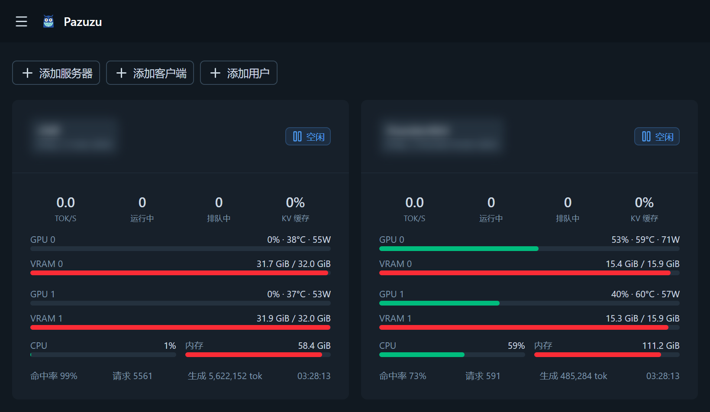
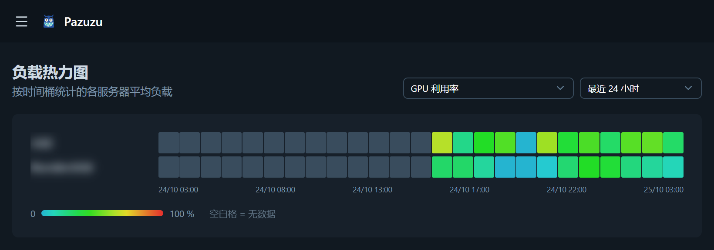

# Pazuzu

[English](../README.md) · [Русский](README.ru.md) · **中文**

**[Strata](https://github.com/Niko1221/Strata)** 推理引擎的 Web
监控系统：多服务器、实时仪表盘、指标历史，以及可选时间范围的负载热力图 ——
还有一个可选的 OpenAI 兼容统一端点，把应用请求均衡地分给所有引擎。





## 功能

- **多服务器** — 通过基础 URL 添加 Strata 引擎
  （例如 `http://192.168.10.76:8000`），指标从 `/metrics` 读取
  （Prometheus 文本格式，需要 `Accept: text/plain` 请求头）。
  可选的 API 密钥以 `Bearer` 令牌发送——新版 Strata
  对外暴露的服务器要求提供。「测试」按钮可立即确认引擎是否可达、
  `/metrics` 能否正常解析。
- **实时仪表盘** — 引擎状态（idle / reading / generating）、
  tok/s、队列、KV 缓存，每块 GPU：利用率 / 显存 / 温度 / 功耗，
  以及主机 CPU 和内存。通过 WebSocket 更新，并支持轮询回退。
- **历史** — 按服务器查看 1 小时 / 6 小时 / 24 小时 / 7 天 / 30 天图表。
- **热力图** — 所有服务器按时间桶的负载，
  时间范围 1 / 3 / 12 / 24 小时 / 7 天 / 30 天 / 一年，可选指标（GPU 利用率、CPU、
  tok/s、队列、显存 %、功耗、命中率等）。时间范围和指标会在浏览器中记住（cookie）。
- **设置** — 轮询间隔和汇总间隔（默认 30 秒）、原始数据和小时聚合的保留深度，
  修改后立即生效；同页的「系统配置」卡片可直接在浏览器中编辑 `config.json`
  （开启验证后仅超级管理员），保存即生效——只有数据库路径需要重启。
- **自更新** — 侧栏显示当前构建的提交，每 6 小时检查一次
  `origin`，侧栏底部的"更新并重启"按钮（设置中也有）一键拉取新代码、
  重新构建并重启服务器（开启验证后仅管理员）。
- **主题** — 浅色 / 深色 / 跟随系统：侧栏（移动端为抽屉菜单）中快速切换或在设置中选择，
  配色方案分“标准”（内置默认：深海岩石中性色上的亮青色强调）
  和“自定义”（手动挑选强调色和中性色板），保存在浏览器中（localStorage）。
- **吉祥物** — 长角咧嘴笑的怪物，笑容是一条青色锯齿状负载曲线：侧栏和
  登录页使用 `public/logo.svg`，标签页图标使用 `public/favicon.svg`；
  空状态页面由一双发光的眼睛守望（`AbyssEyes.vue`）。
- **国际化** — 界面支持英语、俄语、德语、西班牙语、法语和中文；
  语言默认根据浏览器自动检测，可在设置中为账户固定
  （固定前由 `pazuzu_locale` cookie 记住上次选择）。文案位于 `i18n/locales/*.json`，
  新增语言 = 一个 JSON 文件 + `nuxt.config.ts` 中的一条配置。
- **可选的身份验证** — 在 `config.json` 中开启 `auth.enabled`；
  账户存储在 SQLite 中，密码使用 scrypt 哈希，登录有效期 30 天并在使用时
  自动续期，角色分为 `superadmin`、`admin` 和 `user`。开启验证且尚无任何用户时，应用会打开创建首个超级管理员账户的界面。
  也可以通过局域网内的 GitLab 服务器登录（OAuth2，见下文「身份验证」）。
- **API 网关（可选）** — 一个 OpenAI 兼容端点（`/v1`）在所有引擎间负载均衡：
  按应用分配的 API 令牌（`pzz_…`）、带 aging 的优先级队列、会话感知路由
  （同一会话始终落在持有其 KV 前缀缓存的引擎上）、按服务器的网关模式
  （路由 / 排空 / 仅统计）、按客户端的引擎偏好（本机硬件优先）以及来源 IP 记录；「客户端」页面同时也是网关控制台——
  实时队列与各引擎负载一览。默认关闭，在 `config.json` 或设置中开启
  `gateway.enabled` — 见下文「网关（负载均衡器）」。

## 安装

```sh
git clone https://github.com/Crdls/Pazuzu.git
cd Pazuzu
npm install --omit=dev
npm run build
```

如果主机空闲内存不足（比如同时运行着 Strata），安装或构建可能以
退出码 135 被终止 — 限制 Node 堆大小即可：
`NODE_OPTIONS=--max-old-space-size=1024 npm install --omit=dev`（`npm run build` 同理）。

## 更新

运行中的构建就是一个 git 克隆，因此 Pazuzu 知道自己的提交并显示在侧栏中；
点击这一行就会就地检查更新。每 6 小时（或点击"立即检查"时）它会询问
`origin` 分支是否有新提交；
届时侧栏底部（设置中也有）会出现"更新并重启"按钮，供有权者使用
（开启验证后仅管理员）。
该按钮在后台运行 `scripts/autoupdate.mjs`：等待服务器退出，依次执行
`git pull --ff-only`、`npm install --omit=dev`、`npm run build`，
然后重新拉起服务器——新构建响应后页面会自动刷新。整个过程记录在
`data/update.log`；若某一步失败（例如本地改动阻碍了 pull），
旧构建会重新拉起，设置页会显示失败原因。开发模式下不会应用更新。

Linux 运行 `./update.sh`，Windows 运行 `update.bat`，手动执行同样的步骤，
新克隆后同样适用（此时 pull 什么都不做）。之后重启服务器以应用新构建。

## 运行

```sh
node .output/server/index.mjs    # http://localhost:3000
```

开放到局域网（主机和端口任意）：

```sh
NITRO_HOST=0.0.0.0 NITRO_PORT=3003 node .output/server/index.mjs
```

数据库是 SQLite 文件 `data/data.db`（自动创建）。
路径可通过 `config.json` 中的 `db.path` 修改（启动时生效）。
系统设置位于项目根目录的 `config.json`，见下文「身份验证」。

## 身份验证

系统设置位于项目根目录的 `config.json` — 将 `config.json.example`
复制为 `config.json`：

```json
{
  "db": { "path": "data/data.db" },
  "auth": { "enabled": true }
}
```

该文件是可选的（不存在 = 默认值：`data/data.db`，验证关闭）。
`auth.enabled` 在文件修改后立即生效；`db.path` 在启动时生效，修改后需重启
（相对路径相对于项目根目录解析）。超级管理员也可以在设置页面的「系统配置」
卡片中编辑这些设置：保存会就地重写 `config.json`（手工添加的其他键会保留），
值立即生效 — 只有 `db.path` 需要重启。验证关闭时，该卡片像整个应用一样
对网络中的所有设备开放。

开启验证后：

- 尚无任何用户 → 应用打开创建首个超级管理员账户的界面；
- 所有 API 请求和 WebSocket 都需要 `pazuzu_session` cookie
  （HttpOnly，密码为 SQLite 中的 scrypt 哈希，会话有效期 30 天并在使用时续期）；
- 三种角色：`superadmin`、`admin` 和 `user`；管理员可见「用户」页面，可在其中
  更换角色、为任何用户指派新密码（无需知道旧密码）、冻结账户（被冻结者无法
  登录，其活动会话立即失效）以及删除用户 — 但超级管理员除外：他们的账户和
  `superadmin` 角色本身只有超级管理员可以管理；
- 第一个管理员账户就是超级管理员：首启界面创建的账户直接获得该角色
  （首次 GitLab 登录也是如此），只有超级管理员能授予或撤销该角色；
  已有数据库会自动升级 — 启动时若该角色没有活跃持有者，最早注册的活跃
  管理员会成为超级管理员；
- 通过 API 无法把自己锁死：最后一名活跃超级管理员不能被降级、冻结或删除，
  最后一名活跃管理员同样不能（超级管理员也计入），任何人都不能修改自己的
  角色或冻结自己；
- 服务器会记住创建者：只有创建者和管理员可以编辑、删除和启停服务器
  （验证关闭时所有人照旧可操作）；
- 设置页面中的轮询间隔和数据保留仅管理员可用，「系统配置」卡片
  （编辑 `config.json`）仅超级管理员可用（修改密码和外观卡片所有人可用）；
- 「角色预览」（设置页面）：管理员可临时以普通用户身份查看整个界面，
  超级管理员还可以以管理员身份查看 — 便于测试，也便于放心尝试危险操作。
  伪装只对当前会话生效、绝不会增加权限，生效期间侧栏显示横幅，一键即可返回；
- 侧栏可退出登录；在设置页面可修改自己的密码
  （当前会话保持登录，其他会话将被退出）。

### 通过 GitLab 登录

除了本地密码（或与其并存），还可以通过局域网内的 GitLab 服务器以 OAuth2
（authorization code，scope `read_user`）认证 — 无需额外的 IdP 服务：

1. 在 GitLab 中创建 OAuth 应用（个人档案 → 「应用」，或在 Admin Area →
   「应用」中创建以供所有人使用）。redirect URI 必须填写 Pazuzu 的
   OAuth callback 端点的**完整 URL**：
   `http://<pazuzu-主机>:3003/api/auth/gitlab/callback`。GitLab 逐字符
   精确匹配 — 只写主机 `http://<pazuzu-主机>:3003` *不够*：GitLab 会把
   code 送回 `/`，没有任何处理器，结果就是无声地退回登录页。scope 选
   `read_user`；
2. 把应用的 id/secret 写入 `config.json`：

```json
"auth": {
  "enabled": true,
  "gitlab": {
    "enabled": true,
    "baseUrl": "http://gitlab.lan",
    "clientId": "…",
    "clientSecret": "…",
    "allowedGroups": [],
    "caCert": "",
    "insecureTls": false
  }
}
```

- 登录页会出现「使用 GitLab 登录」按钮；
- 首次通过 GitLab 登录时创建同名本地用户并赋予超级管理员角色（仅在所有用户
  尚不存在时可能发生）；之后的 GitLab 登录创建普通 `user` 账户 — 由管理员
  在「用户」页面为其提权；新的 GitLab 用户带有「GitLab」徽标，没有密码，
  可在设置页面设置本地密码（此时表单只要求新密码，不要求当前密码），以便在
  GitLab 不可用时仍能登录；
- `allowedGroups`（可选）只允许这些 GitLab 组的成员登录；子组成员同样
  有效；留空则该 GitLab 的任何用户都可登录；
- `redirectUri`（可选）覆盖从请求推导的 callback 地址 — 仅在会改写主机名的
  reverse proxy 之后才需要。与 GitLab 应用里的设置一样，它必须是以
  `/api/auth/gitlab/callback` 结尾的完整 callback URL，且与 GitLab 中
  注册的完全一致；
- 如果 GitLab 使用内部 CA 签发的证书，浏览器能正常打开，但登录会失败并提示
  「无法通过 GitLab 登录」（服务器日志中是 `SELF_SIGNED_CERT_IN_CHAIN`）：
  Node 不使用操作系统的证书存储。请在 `caCert` 中指向该 CA 证书的 PEM 文件
  （相对路径从项目根目录解析；该 CA 是在常规 CA 基础上*追加*信任）— 或者在
  完全可信的局域网中设置 `insecureTls: true`，仅对 GitLab 请求跳过证书验证。

忘记密码？在服务器上、项目根目录执行（无需邮箱，服务器无需停止）：

```sh
node scripts/reset-password.mjs --list
node scripts/reset-password.mjs <用户名或 id> [新密码]
```

重置会退出该用户的所有会话。

## 网关（负载均衡器）

Pazuzu 还可以作为所有应用调用引擎的唯一入口——在所有引擎前面的一个
OpenAI 兼容端点：

```
POST http://<pazuzu-主机>:3003/v1/chat/completions
Authorization: Bearer pzz_…
```

发往 `/v1` 的一切都会被透明转发（chat completions、models 及其他兼容路由），
包括流式响应。默认关闭——在 `config.json` 中开启：

```json
"gateway": { "enabled": true }
```

或在设置页面的「系统配置」卡片中开启。

- **客户端** — 「客户端」页面（开启验证后仅管理员）管理允许调用网关的
  API 令牌：自动生成 `pzz_…` 密钥（只显示一次，仅存储其哈希）或使用自定义
  令牌；令牌可停用、轮换，带有优先级，每个客户端都有请求计数、来源 IP 记录
  和对引擎的偏好设置。
- **客户端的服务器访问权限** — 可以限制每个客户端可用的引擎集合：在「客户端」
  页面勾选该客户可访问的服务器，在「服务器」页面勾选可使用该服务器的客户
  （两处都有「全选 / 取消全选」按钮）。新客户默认可以访问所有服务器，
  之后新增的服务器也自动可用，除非取消勾选。
- **客户端的引擎偏好** — 在同一个「客户端」对话框里，每个可访问的服务器都可
  标记为「本机」「普通」（默认）或「备用」。路由会优先使用客户端的「本机」
  引擎（在它们之间按负载均衡），之后再落到「普通」；「备用」引擎只在别处都
  无法接收时才使用。偏好与访问权限相互独立（对「所有服务器」的客户端同样
  生效），因此拥有特定机器的客户端在条件允许时会一直用自己本地的硬件。
  会话亲和仍优先于偏好，已开始的对话会留在原引擎上。
- **会话亲和** — 一个会话会继续由持有其 KV 前缀缓存的引擎服务，对话不降温、
  缓存不浪费；空闲超过一小时的会话可能落到其他引擎。
- **最小负载路由** — 在客户端可访问的引擎中，新会话落到其最优先层级里负载
  最小的引擎，每个引擎有可在服务器页面设置的并发上限。当引擎内部队列堆积、
  KV 缓存接近占满，或刚有实时请求在其上失败
  时，该服务器会暂时不接新请求——网关让引擎的内部队列保持为空，优先级才
  有意义。
- **优先级队列** — 所有引擎满载时请求进入高 / 普通 / 低通道，同通道内按
  客户端公平轮转；等待会逐步提升请求，因此不会饿死，等得太久的请求会收到
  礼貌的 `429` 而不是无限挂起。队列存在于内存中——重启 Pazuzu 会丢弃排队中
  的请求（进行中的会正常完成）。
- **网关控制台** — 「客户端」页面顶部显示端点地址、各通道排队数，以及每个
  引擎的方块：在途请求数、是否正在排空或被暂时跳过。
- **从网关注摘除服务器** — 服务器页面的网关模式：**路由**（默认）、
  **排空**（只完成进行中的请求）、**统计**（仅监控，网关不再转发）。

<details>
<summary>技术细节</summary>

- **每服务器并发上限**：服务器页面的「网关并发」字段，否则用引擎自身批处理
  槽位（`strata:live_slots`），否则 `defaultCapacity`（32）。
- **临时摘除触发条件**：引擎等待队列大于零、KV 缓存 ≥ 95%，或刚有实时请求
  在该服务器上失败（`ejectionS`，30 秒）。
- **会话键**：客户端发送 `X-Session-Id` 头时以它为准，否则以对话开头
  （system + 首条用户消息）的哈希为键；空闲超过 `sessionIdleMin`（60 分钟）
  的会话可能落到其他引擎。
- **队列 aging**：等待 30 秒后 低 → 普通，再等 5 分钟 → 高；等待超过
  `queueTimeoutS`（60 秒）或触及 `queueMax`（200）/ `queueMaxPerClient`
  （20）的请求收到带 `Retry-After` 的 OpenAI 风格 `429`。
- **调试标记**会给客户端的响应加上 `X-Pazuzu-Server`、
  `X-Pazuzu-Queue-Wait-Ms`、`X-Pazuzu-Session` 头。
- **token 用量**在客户端索取 `usage` 数据块（如 `stream_options.include_usage`）
  时从引擎响应统计，否则按字节数/4 估算——是统计，不是账单。
- `config.json` 的 `gateway` 段可调整 `queueTimeoutS`、`queueMax`、
  `queueMaxPerClient`、`sessionIdleMin`、`defaultCapacity`、`ejectionS`；
  同样的字段也在设置页面的「系统配置」卡片里。

</details>

## 数据存储

| 层级 | 粒度 | 默认保留期 |
|---|---|---|
| `samples` | 每个轮询周期（约 10 秒） | 48 小时 |
| `rollup_hourly` | 小时桶（avg/max/min） | 400 天 |
| `rollup_daily` | 天桶 | 永久 |

采集时计数器（`*_total`）会被转换为速率（`derived:*`）：
`gen_tok_s`、`prompt_tok_s`、`req_s`、TTFT / ITL / E2E 的窗口平均值
`_sum/_count`，以及引擎和显存占用百分比。

## 项目结构

```
app/            Vue 3 + Nuxt UI 前端
  pages/        仪表盘、服务器详情、热力图、服务器列表、客户端、用户、设置、登录
  components/   ServerCard、MetricChart (uPlot)、LoadHeatmap 等
  plugins/live.ts  共享状态 + WebSocket 客户端
i18n/locales/   语言词典：en、ru、de、es、fr、zh
server/
  middleware/   auth.ts — /api 的会话关卡（由 config.json 开启）
  utils/        Prometheus 解析器、SQLite、指标目录、采集器、汇总、认证原语、
                权限规则、GitLab OAuth 辅助、gateway/（路由、优先级队列、会话亲和、代理）
  plugins/      后台循环（scrape、rollups、gateway、更新检查）
  api/          servers CRUD、live、range、heatmap、settings、config、auth、
                users、gateway（状态、客户端、轮换、IP）、
                update（status/check/apply）
  routes/       _ws.ts WebSocket 端点、v1/[...].ts 网关代理
scripts/        reset-password.mjs — 密码恢复（无需邮箱）
                autoupdate.mjs — "更新"按钮执行：pull + install + build + 重启
                                 （日志：data/update.log）
test/           基于真实 /metrics 固定数据的解析器测试 + 认证/配置/网关/更新测试
update.sh|.bat  一键安装/更新：pull + install --omit=dev + build
```

## API

- `GET|POST /api/servers`、`PATCH|DELETE /api/servers/:id`、`POST /api/servers/:id/ping`（PATCH/DELETE：开启验证后仅创建者或管理员可调用）
- `GET /api/live` — 所有服务器的当前快照
- `GET /api/range?serverId&metric&from&to` — 指标历史（raw/hourly/daily — 数据源自动选择）
- `GET /api/heatmap?metric&period=1h|3h|12h|24h|7d|30d|1y` — 服务器 × 时间桶矩阵
- `GET|PUT /api/settings`（`PUT`：开启验证后仅管理员）
- `GET|PUT /api/config` — 读取并重写 `config.json`（开启验证后仅超级管理员；除 `db.path` 外全部立即生效）
- `GET /api/update/status` — 当前提交与更新可用性；`POST /api/update/check` — 立即重新检查；`POST /api/update/apply` — 通过 `scripts/autoupdate.mjs` 拉取、构建并重启（开启验证后仅管理员；开发模式下禁用）
- `/api/auth/status|setup|login|logout|password` — 身份验证（公开：status、setup、login、logout）
- `POST /api/auth/view-as` — 将当前会话伪装为更低角色（`user`；超级管理员还可 `admin`；`null` 取消伪装）
- `GET /api/auth/gitlab/start` — 重定向到 GitLab；`GET /api/auth/gitlab/callback` — OAuth callback：请把这一 URL 原样注册为 GitLab 应用的 redirect URI
- `GET /api/users`、`PATCH|DELETE /api/users/:id` — 用户管理（仅管理员；PATCH 接受 `role`、`disabled`、`password`；超级管理员账户与 `superadmin` 角色仅超级管理员可管理）
- `GET /api/gateway/status` — 队列通道与各服务器的网关负载（开启验证后仅管理员）
- `GET|POST /api/gateway/clients`、`PATCH|DELETE /api/gateway/clients/:id`、`POST /api/gateway/clients/:id/rotate`、`GET /api/gateway/clients/:id/ips` — 网关 API 令牌（开启验证后仅管理员；POST/rotate 只返回一次原始令牌；视图和 POST/PATCH 带有 `serversAll`/`serverIds` 以及 `serverPriorities`——形如 `{serverId: "high"|"normal"|"low"}` 的引擎偏好映射）
- `PUT /api/gateway/servers/:id/clients` — 设置哪些客户可以使用该服务器（开启验证后仅管理员）
- `/v1/**` — OpenAI 兼容网关，用客户端自己的令牌认证（`Authorization: Bearer pzz_…`），不用会话 cookie — 见上文「网关（负载均衡器）」
- `WS /_ws` — 推送快照

## 测试

```sh
node test/parse.test.mjs
node test/auth.test.mjs
node test/config.test.mjs
node test/gateway.test.mjs
node test/client-access.test.mjs
node test/update.test.mjs
```

## 备注

- 需要 Node ≥ 22.22 / 24.15（较旧的 Node 24 上 Nuxt 4.6 可能
  报 EBADENGINE 警告）。
- `nuxt.config.ts` 中有两个重要的环境绕行配置：
  - `nitro.externals.inline` — 仅在 Windows 上需要的临时方案，
    等待 [nuxt/nuxt#36467](https://github.com/nuxt/nuxt/issues/36467)
    修复（否则整个 SSR 返回 500）；
  - `nitro.experimental.websocket: true` — 在服务端预设中启用
    WebSocket 升级挂载（否则 `/_ws` 在开发和生产环境都无法工作）。
- 若没有 `Accept: text/plain` 请求头，Strata 的 `/metrics`
  会返回 JSON — 采集器始终发送该请求头。
- 身份验证默认关闭（本服务面向受信任的本地网络）；开启后，除认证引导接口外，
  所有 `/api` 和 `/_ws` 都需要有效的会话 cookie。
- `/v1` 网关默认同样关闭，并且有意*不*用会话 cookie 把关——客户端在那里
  用自己的 `pzz_…` API 令牌认证。

## 致谢

向 [Niko1221](https://github.com/Niko1221/Strata) 致以最深的敬意 —— 他是
[Strata](https://github.com/Niko1221/Strata) 推理引擎的作者，本监控观察的正是它：
没有它，这里就没有任何图表可看。

本监控建立在这些开源项目之上：

- [Nuxt](https://nuxt.com/) 4（基于 [Vue](https://vuejs.org/) 3，
  由 Nitro 提供服务）— 界面、API 路由与 WebSocket；
- [Nuxt UI](https://ui.nuxt.com/) 与 [Tailwind CSS](https://tailwindcss.com/)
  — 组件与样式，[Lucide](https://lucide.dev/) 图标；
- [uPlot](https://github.com/leeoniya/uPlot) — 历史图表；
- [better-sqlite3](https://github.com/WiseLibs/better-sqlite3) — SQLite 存储；
- [Nuxt i18n](https://i18n.nuxtjs.org/) — 六种界面语言；
- [TypeScript](https://www.typescriptlang.org/) — 以上全部。

## 许可证

本项目按 [MIT 许可证](../LICENSE) 条款发布 — 完整文本见仓库根目录下的
[`LICENSE`](../LICENSE) 文件。
